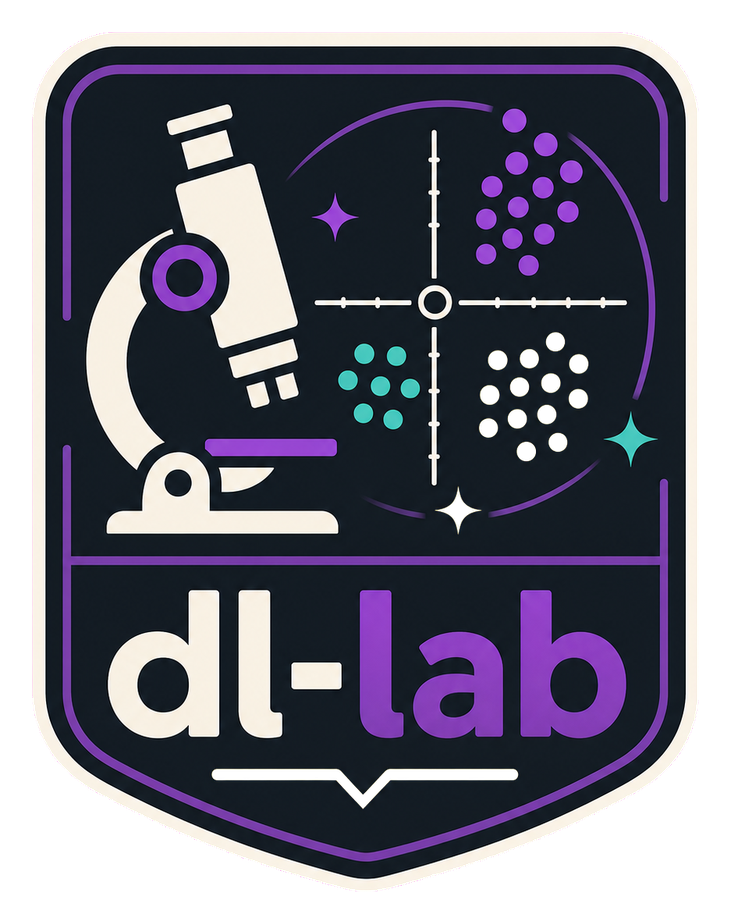

<p align="center">
  
  <br />
  <!-- repo-tagline:start -->
  <strong>🧪 Run reproducible deep learning experiments locally and in cloud 🧪</strong>
  <!-- repo-tagline:end -->
</p>

dlab runs controlled deep-learning experiments from Hydra configs. It includes
PyTorch Lightning recipes for classifiers and autoencoders on MNIST,
Fashion-MNIST, and CIFAR-10.

## Quickstart

Install the locked environment and run a local MNIST debug pass:

```bash
git clone https://github.com/tsilva/dlab.git
cd dlab
uv sync --locked --no-config --exclude-newer '7 days' --exclude-newer-package=hydra-core=2026-10-25T13:42:23Z --extra dev
```

```bash
uv run python train.py experiment=mnist_mlp trainer=debug dataset.num_workers=0
```

The debug configuration exercises the training loop before longer runs.
The guide covers research tracks, sweeps, remote launchers, and where results
are stored.

[Read the dlab experiment guide](https://github.com/tsilva/dlab/blob/main/docs/dlab-guide.md) for the full reference.
